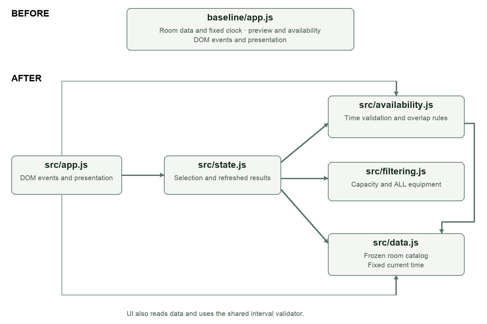
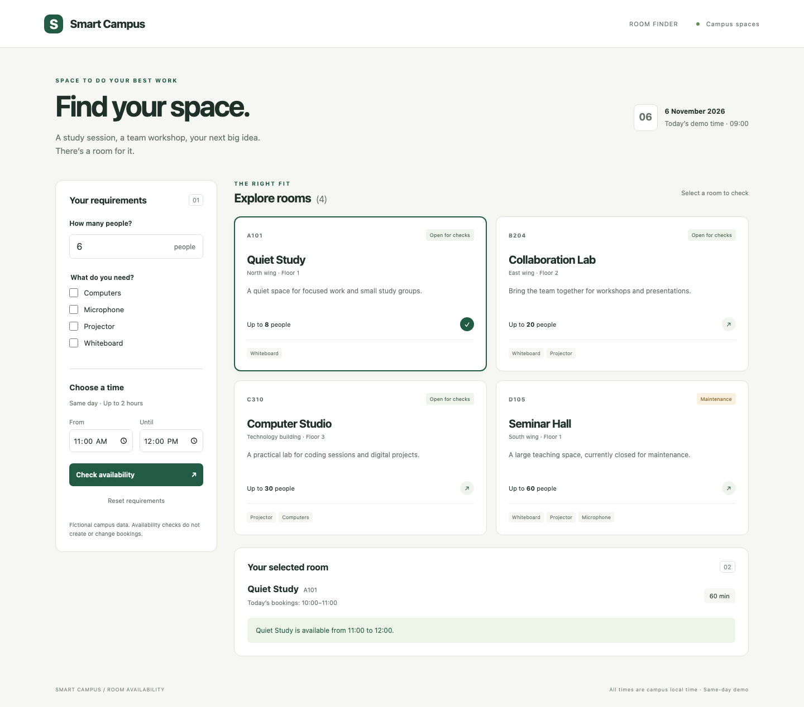

# Smart Campus Room Availability Checker

Rakhimov Ruslan
6 November 2026

### Purpose and result

This report documents the reconstruction and evolution of a minimal room availability checker. A working one-room baseline was extended to four rooms, capacity and equipment filters, and refreshed room-specific results. The final solution separates data, domain rules, filtering, derived state and presentation. All 55 automated checks pass: 41 unit and regression checks plus 14 real-browser checks.

The original Assignment 03 source was not provided. The baseline is a new equivalent minimal version, as permitted by Assignment 04, and is preserved under baseline/ and in Git commit 164529c. This is an extension of that working reconstruction, not a repetition of the Practice 08 debugging exercise.

### Scope and fictional catalog

| Room | Seats | Equipment | Status |
| --- | --- | --- | --- |
| A101 Quiet Study | 8 | Whiteboard | Open |
| B204 Collaboration Lab | 20 | Whiteboard, Projector | Open |
| C310 Computer Studio | 30 | Projector, Computers | Open |
| D105 Seminar Hall | 60 | Whiteboard, Projector, Microphone | Blocked |

### Availability contract

The fixed demo date is 6 November 2026 and current time is 09:00. Input uses same-day HH:mm times. Start must be at or after now, end must be later, and duration must be no more than 120 minutes. Bookings use half-open intervals [start, end), so touching endpoints do not overlap. Checks never create or modify bookings. There is no login, payment, database or live API.

The AC labels below operationalize the short AC1–AC6 summaries in the supplied Assignment 04 PDF. They do not claim access to a separate, full Assignment 03 specification.

---

## Codebase analysis and implementation plan

The assistant received the assignment PDF, repository map, acceptance criteria and constraints. Before feature edits, docs/plan-before-changes.md recorded the risks and priorities. Baseline tests passed 8/8, and the analysis was saved in commit 3cce6da before the feature implementation commit 21e8f70.

### Maintainability risks in the reconstructed baseline

| Reference | Risk | Planned improvement |
| --- | --- | --- |
| baseline/app.js
preview and check | Duration validity and the 120-minute predicate are repeated. | One validateInterval function used by rendering and availability. |
| baseline/app.js
room and now | Fixture data and time policy share a file with DOM events. | Separate the immutable catalog and fixed clock. |
| baseline/app.js
check | Default argument silently selects the global room. | Require the room explicitly; derive selection from current matches. |
| baseline/app.js
DOM listeners | Presentation and domain behavior change in the same module. | Keep DOM work in app.js and test rules without a browser. |

### Priorities before editing

1. Preserve a working single-room version and its regression evidence.

2. Extract shared interval validation; add four-room fixtures and pure filtering.

3. Derive matching rooms, selection and availability together to prevent stale results.

4. Add a responsive interface with explicit errors and room-specific bookings.

5. Run unit and real-browser checks, review changes and commit each completed step.

6. Record measured quality changes, limitations, diagrams and AI-use evidence.

### Suggestion rejected or modified

A framework scaffold, component library and global state store were considered by the assistant. The implementation instead uses browser-native ES modules and one small derived-state function. Four static rooms and one screen do not justify the added framework configuration. This records a design proposal considered in the session, not a fabricated quotation from an external model conversation.

---

## Refactoring and final architecture

The baseline combined data, validation and DOM events in one production JavaScript module. The final application has five modules with direct dependencies and no service layer, state library or build pipeline. The preserved baseline remains runnable at /baseline/.

### Design decisions

1. Use pure rules and one interval validator. src/availability.js validates time once for both UI feedback and availability checks. src/filtering.js requires capacity greater than or equal to attendees and uses every() to require all selected equipment. Small functions can be exercised without a browser.

2. Recompute derived state after every input and selection change. src/state.js obtains matches, retains the selected room only if it still matches, and calculates that room’s result. If filtering removes the selection, it selects the first match; if no rooms match, it clears the result. This is an explicit product policy, not a hidden fallback to another room’s booking data.

3. Freeze fixture data at every nested level. Room records, equipment arrays, booking arrays and booking objects are frozen. Checks only read them. src/app.js handles events and rendering; CSS and semantic HTML define presentation. A small static server is development infrastructure rather than an extra product layer.

### Behavior preserved

Original AC1–AC5 checks remain executable, and an eight-case parity loop compares baseline and final boolean availability on identical room/time inputs. Error wording improves, while valid-time, duration, blocked-room, overlap and immutability outcomes remain consistent. New room and filtering behavior is tested separately.

---

## Automated testing and requirement coverage

Recorded environment: macOS arm64, Node.js v25.2.1, Playwright 1.62.1 and headless Chromium. The declared project requirement is Node.js 22 or later. Browser tests start their own local server on port 4174; application runtime code uses no external dependencies.

| Command | Actual result | Evidence |
| --- | --- | --- |
| npm run test:baseline | 8 / 8 passed | baseline-tests.txt |
| npm test | 41 / 41 passed | final-unit-tests.txt |
| npm run test:ui | 14 / 14 passed | browser-tests.txt |
| npm run test:all | 55 / 55 passed | final-all-tests.txt |

The final 41-check unit suite includes the eight preserved baseline checks and 33 new domain/state checks. The 14 browser checks are additional. Counts represent executable test cases; individual assertions and the parity loop are not counted as separate tests.

| Requirement | Executable evidence |
| --- | --- |
| AC1 Valid time | Strict HH:mm, past/current start, missing input, equal/reverse/overnight endpoints; browser input errors. |
| AC2 Duration | One minute and exactly 120 minutes accepted; 121 minutes rejected in domain and UI. |
| AC3 and F3 Blocked room | D105 is never available and displays maintenance in the browser. |
| AC4 Overlap | Touching either endpoint allowed; one-minute, contained, containing and identical overlap rejected. |
| AC5 Immutable data | Snapshot comparison after checks and filtering; frozen nested objects; submit does not mutate data. |
| AC6 Clear responsive feedback | Labels, live region, keyboard focus and no overflow at 390px; desktop/mobile captures. |
| F1 and F2 Filters | Exact/insufficient capacity, ALL-equipment semantics, combined filters and invalid counts. |
| F4 and F5 Results | Empty state, clearing old result, own-room bookings, filter-driven selection and time changes. |

### A defect discovered by integration testing

The first browser run passed 10/14 cases. A button with id="reset" shadowed the native form.reset method. Renaming it to reset-requirements fixed the product defect. The test error collector was also cleared before each case, removing three misleading follow-on failures. Both the failed log and corrected 14/14 log are retained. This is concrete evidence that browser tests affected the implementation.

---

## Quality evaluation with measured evidence

Measures are taken from executable logs and direct source inspection. The larger final suite includes new requirements; it should not be interpreted as the same 55 tests being run against the one-room baseline.

| Measure | Baseline | Final | How measured |
| --- | --- | --- | --- |
| Automated tests passed / total | 8 / 8 | 55 / 55 | Raw Node and Chromium outputs; final includes baseline tests. |
| Duration validation locations | 2 | 1 | preview and check repeat the baseline predicate; final uses validateInterval. |
| Duplicated logic locations removed | Not applicable | 1 | Two copies reduced to one shared source; no claim of a whole-project clone analysis. |
| Production JS modules | 1 | 5 | baseline/app.js versus five files in src/; server and tests excluded. |
| Responsibilities | Data, rules and DOM combined | Data; rules; filters; state; UI | Module imports and exported functions inspected. |
| Real-browser coverage | Not recorded | 14 passing cases | tests/ui.test.mjs; 1440px desktop and 390px mobile viewports. |

### What the change means

Module count rises because independent responsibilities are separated, not because extra architectural layers were introduced. Availability and filtering are pure, while state derivation provides one place to refresh the chosen room. The duplicate-duration count is deliberately narrow and reproducible: two baseline predicates become one final predicate. evidence/quality-metrics.json records the method and observed values.

### Remaining limitations

The product handles one fixed fictional day and does not support recurring or overnight bookings. Checks do not reserve a room or persist changes. Multi-user booking conflicts and authorization are outside scope. The static server is for local coursework, not production hosting.

Automated browser coverage uses Chromium only. A 390px overflow assertion and visual captures support the responsive claim for the tested sizes, not every device. Labels, keyboard behavior and live-region attributes are checked, but no human screen-reader audit has been performed.

### Next improvements

First obtain human accessibility feedback and test another browser engine. If requirements expand to dates or actual bookings, define date/time policy, authorization and concurrency rules before adding storage. These would be new product requirements rather than hidden additions to this assignment.

---

## Demonstration of the final interface

The final screen shows the requirements panel, filtered room catalog, selected room bookings and a live availability result. The image below is an actual Chromium capture of the implemented application at a 1440px viewport, not a design mockup.

### Repeatable scenarios

Successful filtering: choose Projector and Whiteboard to retain B204 and D105. Unsuccessful filtering: choose Computers and Microphone to show the empty state. Room switching: at 11:00–12:00, A101 is available and C310 is booked. D105 always displays maintenance.

Additional captures in evidence/ show filtered.png, empty.png, switched.png, blocked.png and mobile.png. Browser tests verify these interactions, and mobile.png records the single-column layout with C310 selected.

---

## AI use record and verification appendix

### Tool and context

Tool: OpenAI Codex desktop, GPT-6 family coding assistant. Date: 6 November 2026. A more specific deployment identifier is not exposed in the session, so none is claimed. The assistant used local shell/file tools, Node tests, Playwright Chromium, Python document tooling, and the Documents and PDF skills.

The user supplied the assignment PDF and asked what was required, then authorized a reconstructed minimal version and a complete formatted submission. The actual follow-up was: “можешь сделать все и оформить” and “сделай аналогичную минимальную версию, подготовь репорт или что там просится”. The user also required simple solutions, English code/comments, testing and commits after each step, and local main without branches or worktrees.

### Outputs used and decisions

| Output | Evidence or decision |
| --- | --- |
| Working reconstruction | baseline/ and commit 164529c; eight passing checks before extension. |
| Structured analysis | docs/plan-before-changes.md and commit 3cce6da recorded before feature edits. |
| Feature and refactoring | Four-room catalog, pure domain/filter modules and derived state; commit 21e8f70. |
| Verification and correction | 55 passing tests; browser reset defect fixed in commit 7295cf0. |
| Report and reflection | Generated from actual source, test logs and captures. Student review status is explicit. |

### Verification sources

The assignment PDF, pages 5–21 and 25–31, is the source of scope, tasks and submission requirements. Local evidence consists of tests/baseline.test.js, tests/domain.test.js, tests/ui.test.mjs, the logs in evidence/, quality-metrics.json, screenshots and Git history. The optional Agent Skill/MCP extension is not used as a substitute for the six graded tasks. No new Agent Skill was created.

### Human review status

Codex executed automated tests and inspected the screenshots and document layout. The student has not yet reported personally reviewing the code or running the tests. These actions are therefore not attributed to the student. Before submission, the student should run the commands, inspect the demonstrated behavior, read the report and revise the reflection to reflect only work actually verified. The full AI-use record is in docs/ai-evidence.md.

---

## Reflection on the AI assisted workflow

The AI assistant received the assignment requirements, a map of the reconstructed repository, and explicit constraints: fictional data, a fixed current time, no database, and preservation of the existing availability rules. This context kept the work focused on extending a small application rather than replacing it with an unrelated system.

The most useful suggestions were separating the room catalog from availability rules, extracting a shared interval validator, and deriving selection and availability together. These changes made it possible to test filtering independently and prevented an old room result from remaining visible after a selection change. A framework and global state store were considered but rejected because browser modules and one state function were sufficient for four rooms.

Verification during this session included baseline regression tests, boundary checks, before and after outcome comparisons, and automated interaction with a real Chromium browser. Codex executed these checks and inspected desktop and mobile screenshots. This is evidence of tool execution, not a claim that the student personally performed the review. The student must run the commands and inspect the application before making that claim.

Tests directly influenced the implementation. Browser testing found that a button identifier shadowed the form reset method. Renaming the button fixed the actual defect, while resetting the browser error collector between tests prevented misleading follow-on failures. The unsuccessful run was retained alongside the passing results.

The next improvements would be a human accessibility review, additional browser coverage, and an explicit date model if the product scope expands beyond a single day. Persistence would require separate requirements for authorization and concurrent booking conflicts.

Word count: 262. Prepared as an accurate account of the assisted session; student review remains required.

### Submission contents and references

The package contains initial and final source code, README setup/run/test commands, executable tests and real results, the analysis/refactoring report with diagrams and quality comparison, this reflection, and an AI evidence appendix. A Git bundle preserves local main history in addition to the source files in the ZIP.

Assignment source: Lesson 08 Software Engineering Assignment 04, supplied course PDF. Requirements and task descriptions: pages 5–21. AI-use and deliverables: pages 25–27. Email and deadline: pages 28–31. The report uses those requirements without claiming access to the earlier course handouts listed as references.

Submission recipient: kibo.kz.contact.01@gmail.com. Subject: Software Engineering - Assignment #04 - Rakhimov Ruslan. Deadline stated in the PDF: 8 November 2026, 23:59:59; timezone not specified. Do not copy z.aldamuratov@kbtu.kz. No email has been sent.
